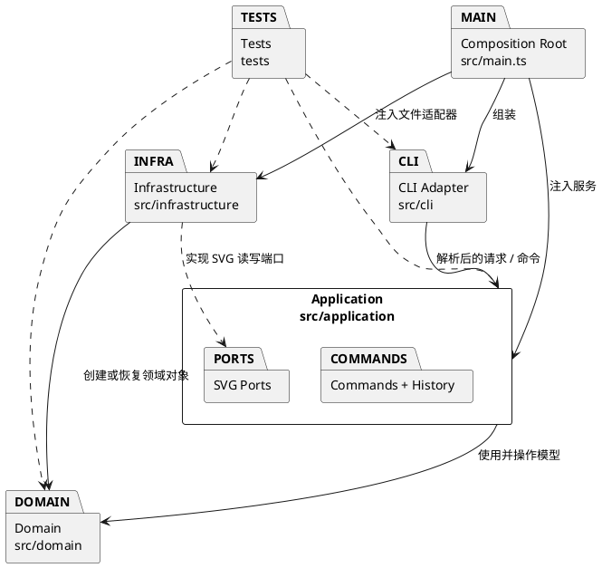

# SVG 编辑器（CLI）架构方案

> 本文记录 Phase 1 的架构约定、实现过程和最终验证结果。方案部分描述目标边界；一致性与质量保证部分以当前代码和已执行检查为准。

## 架构方案

### 1. 模块划分

计划采用以下目录。类按“一类一文件、文件名与类名一致”组织；同一模块中仅将紧密相关的小型类型与其所属类放在一起。

| 模块 | 职责 |
|---|---|
| `src/domain/` | SVG 文档、画布及图形对象模型。以抽象 `Shape` 和多态子类表达图形；`GroupShape` 作为 Composite 容器，维护父子关系与同级顺序；负责文档内 id 唯一性、几何操作、属性约束及图形自身的树摘要。不处理终端输入、文件系统或 XML。 |
| `src/application/` | 应用用例与编辑流程。定义 `Command` 抽象、具体命令、命令执行/撤销历史、命令分发、tree/show/help 查询输出，以及 SVG 读写所需的应用端接口。每条编辑命令负责一次完整操作及其逆操作。 |
| `src/cli/` | REPL、逐行输入、注释行处理、命令词法/语法解析、帮助和终端输出。将已解析输入转换为应用命令，不直接修改领域对象。 |
| `src/infrastructure/` | 应用端口的外部适配器：SVG XML 解析与序列化、文件读写。使用不处理外部实体的 SAX 解析器；负责缺失 id 的自动分配及警告所需的信息传递；不承载 CLI 业务规则。 |
| `src/` 组合根 | `main.ts` 创建领域文档、应用服务、文件适配器与 CLI，并注入依赖；只负责组装，不实现编辑逻辑。 |
| `tests/` | 对领域模型、命令及撤销重做、CLI 解析、SVG 往返和端到端典型会话进行验证；测试可依赖被测模块。 |
| `doc/` | 架构方案、过程记录、一致性自查和质量保证说明。 |

### 2. 设计模式的选择

- **Command（必须）**：每种编辑操作由独立命令对象表示，统一提供执行和撤销行为。应用层历史记录按成功执行的编辑命令管理 undo/redo；执行失败的命令不得进入历史。组合操作（例如 `group`）作为单个命令，须先验证全部目标，再一次性修改文档，避免失败后留下部分状态。
- **Composite**：所有图形继承统一的 `Shape` 抽象；叶子图形与 `GroupShape` 通过多态实现共同的寻址、移动、缩放、删除和属性操作。容器递归操作子孙；SVG 序列化由基础设施遍历统一的图形树完成，`ungroup` 则作为明确的结构操作。
- **Adapter / Ports and Adapters**：应用层声明 SVG 读取/保存端口，基础设施实现文件与 XML 适配；CLI 只负责交互和语法解析。这样命令与模型不依赖具体终端或文件库。
- **两处类型名分派（按阶段要求保留并标记为待演进点）**：
  1. `src/cli/` 的命令注册表将命令名映射到命令创建/执行入口；
  2. `src/domain/` 的图形工厂将图形类型名映射到对应类。

  这是本阶段明确允许的按名字分派边界，集中在注册/创建入口；图形行为本身使用多态，不在业务代码中散布 `switch(tag)`。若后续需要第三方命令或图形扩展，再将这两处静态映射演进为可注册机制；本阶段不提前实现插件系统，`box` 也不属于本阶段功能。

### 3. 依赖方向规则

1. `domain` 不依赖 `cli`、`application`、`infrastructure`；领域模型不得读写文件或解析命令。
2. `application` 可以依赖 `domain` 及自身声明的端口；不得依赖 CLI、文件系统实现或具体 XML 库。
3. `cli` 可以依赖 `application` 暴露的用例/命令接口；不得直接修改领域对象，也不得依赖基础设施实现细节。
4. `infrastructure` 可以依赖其实现的应用端口和 `domain` 类型；不得反向控制应用流程或依赖 CLI。
5. 只有 `src/main.ts` 组合根可以同时依赖 CLI、应用层和基础设施，以完成依赖注入。
6. `tests/` 可以依赖被测模块；生产模块不得依赖测试代码。

违反上述规则的生产依赖须记录为待处理项，并优先通过端口、依赖注入或领域对象自身行为纠正，而不是以跨层快捷调用绕过边界。

### 4. 变化点假设

| 可能变化的部分 | 本阶段的处理 |
|---|---|
| 新增编辑命令、调整命令参数 | 每条命令独立实现并纳入命令注册表；解析与领域行为分离。命令注册表是唯一按命令名分派点。 |
| 新增图形类型或改变图形行为 | 统一 `Shape` 抽象与具体类；工厂集中图形类型映射，叶子和容器行为通过多态实现。本阶段不建设插件加载机制。 |
| SVG 文件格式细节或 XML 库 | 通过读写端口隔离适配器；XML 解析依赖的具体包在检查/建立项目配置时再确定。 |
| undo/redo 策略与历史限制 | 通过命令的执行/撤销契约和应用层历史管理；文档类操作与画布尺寸修改统一形成历史屏障。 |
| 新的终端交互方式 | CLI 作为独立适配器；应用命令不依赖 REPL，可由另一种交互入口复用。 |
| `box` 等复合图形插件 | 暂不实现。当前 Composite 模型和集中工厂为后续扩展留出位置，但不为尚未要求的插件机制增加复杂度。 |
| 远程存储或其他文件目的地 | 暂不抽象成通用存储平台；仅通过 SVG 端口隔离本阶段所需的本地读写。 |

## 过程记录

- 阅读 `phase_cli_1.md` 后，将工作拆分为先检查并确定架构，再搭建 CLI、领域模型、命令与撤销重做、SVG 读写、测试和交付。
- 按用户要求采用逐步完成、逐步提交远程仓库的推进方式；每一步完成并验证后再开始下一步。
- 步骤一检查发现工程目录尚无实现代码或项目配置；本地 Git 尚无提交，已配置 `origin`，远程当前没有分支。因此本方案先明确模块边界和依赖方向，不假设现有代码结构；后续项目初始化时按实际依赖和工具链补充实现细节。
- 步骤二建立了 TypeScript 工程配置、`src/main.ts` 组合根、`src/cli/Cli.ts` REPL，以及 `src/application/CommandExecutor.ts` 应用边界。当前由 `UnimplementedCommandExecutor` 明确提示命令尚未实现；后续命令实现时会替换它。REPL 支持 `exit` / `quit`，忽略空行与 `#` 开头的整行注释。
- 步骤三在 `src/domain/` 增加抽象 `Shape`、`RectShape`、`CircleShape`、`EllipseShape`、`LineShape`、`TextShape`、`GroupShape`、`SvgDocument` 与 `DomainError`。文档以 id 查找图形并验证整棵子树的 id 唯一性；容器递归实现移动/缩放，文档提供添加、删除、重归属和顺序控制，同时拒绝无效父子循环。几何值要求有限数值，尺寸和半径不得为负，缩放因子必须为正。领域单元测试使用 Node.js 内置测试运行器。
- 步骤四增加 `DocumentSession` 与文档命令入口，支持 `init`、`canvas` 和未初始化时报错；领域树操作提供删除、重归属、`ungroup` 原位提升以及同级 `front` / `back` 顺序调整。非法画布尺寸在修改前完成校验，不会覆盖当前文档。步骤五已将文档命令统一纳入命令注册入口。
- 步骤四验证中，`node --test tests` 在本 Windows/Node 环境把目录当成模块路径，失败；改为 Node 原生 glob（`node --test tests/*.test.mjs`）后稳定发现两组测试。该行为已记录并更新 npm test 脚本。
- 步骤三的首次循环测试未建立实际的祖先/后代关系，未能验证预期拒绝行为；检查用例结构后将第二个容器挂到第一个容器下，再验证反向移动会被拒绝且结构保持不变。另根据同级重排测试明确索引表示最终位置，确保无效索引不改变顺序。
- 步骤四 `npm test` 构建并运行 11 项测试，覆盖领域模型、结构操作及 `init` / `canvas` 错误场景，全部通过；`npm run typecheck` 通过。CLI 交互式输入冒烟检查确认 `init`、尺寸读取和修改正常。
- 步骤五完成 `Command` 对象、`CommandFactory` 命令名注册入口、`ShapeFactory` 图形类型入口及带双引号参数的 `CommandParser`。编辑命令覆盖 create/delete/move/scale/set/group/ungroup/addto/front/back；Command 保存必要快照供下一步历史管理使用。发现嵌套容器操作可能在子孙变换中途溢出后留下部分状态，因此在编辑命令层保存并恢复子树快照，并为数值变换增加有限值校验；测试验证失败后状态完全还原。`box` 按阶段约定仍报未知图形类型。
- 步骤五 `npm test` 共 19 项测试全部通过，`npm run typecheck` 通过；CLI 典型编辑会话冒烟检查通过。
- 步骤六增加应用层 `CommandHistory`，Command 通过 `historyEffect` 区分 edit/barrier/skip；undo/redo 作为命令走同一分发路径。失败编辑不会写入历史或清除 redo；成功的新编辑会清空 redo；`init`、尺寸修改形成屏障并清理旧历史，`canvas` 查询不影响历史。测试覆盖编辑类型、redo、屏障和组合 group 单步撤销；`npm test` 24 项全部通过，`npm run typecheck` 通过。
- 步骤七引入 `saxes` 解析 XML，应用层通过 `SvgFilePort` 隔离文件 IO；基础设施实现读回六种内置元素、嵌套容器、文本/样式及基本 SVG group 的 `transform` 保留，序列化为合法 XML。读回为整棵树预留已有 ID，再给缺失 ID 分配标签名加序号并输出警告；拒绝 DTD、非法 XML 和不支持的 SVG 元素。`read` / `save` 成功时更新当前路径并形成历史屏障；文件失败映射到规定的 `cannot read/write file` 错误，失败读取不替换当前文档。
- 步骤七发现参数引号内的反斜杠原本会被词法器当作通用转义，导致 Windows 绝对路径被破坏；将转义收窄为仅处理引号和反斜杠自身，并添加 Windows 路径回归测试。`npm test` 29 项全部通过，`npm run typecheck` 通过；覆盖 XML round-trip、空 ID 补齐/冲突规避、非法 XML、DTD、缺失文件、不可写路径及读写历史屏障。
- 步骤八在同一 `CommandFactory` 增加 `tree`、`show`、`help` 显示命令，并以 `historyEffect=skip` 保证其不进入 undo/redo。树摘要由 Shape 子类多态提供，结构分支由应用命令递归拼接；help 列出本阶段完整命令和六种内置图形。tree/show/help 输出格式、缺失 id、显示不影响历史均有测试覆盖；`npm test` 32 项全部通过，`npm run typecheck` 通过。
- 步骤八的反馈格式测试指出 move 命令第一次改进撤销摘要时误复用了操作前的位置作为移动成功位置；从移动后的模型重新读取几何值后修正，成功和撤销反馈均由测试锁定。
- 步骤九按阶段说明逐项回放完整 CLI 会话和两节点流程图用例，并补充端到端验收测试。规格核对发现两处边界行为偏差：`in` 指定不存在的容器时应报告 `no such container`，以及 `group` 收编节点时应保留每个原父容器中的原始相对顺序，即使命令参数顺序不同；已修正实现并增加回归测试。`npm test` 共 35 项通过，`npm run typecheck` 通过。
- 最终依赖方向抽样检查确认领域层没有应用层、CLI、基础设施或外部运行时依赖；应用层没有 CLI、基础设施或文件/XML 库依赖；CLI 仅通过应用层执行器接口调用用例。基础设施经应用端口和领域类型工作，组合根负责组装。`npm audit` 未发现依赖漏洞。

## 一致性自查

**状态：完成。** 已建立 `src/cli/`、`src/application/`、`src/domain/`、`src/infrastructure/` 和 `src/` 组合根，符合当前阶段的模块规划；`tests/` 存放领域、应用、解析、历史、显示、IO 和端到端验收测试。CLI 依赖应用层 `CommandExecutor` 接口，命令创建集中于应用层 `CommandFactory`，图形类型创建集中于领域层 `ShapeFactory`；基础设施实现应用层 `SvgFilePort`，组合根负责注入。检查生产导入关系确认领域模型不依赖 CLI、应用层或基础设施，应用层不依赖 CLI、基础设施实现或具体 XML/文件库，CLI 不直接操作领域对象；没有发现需要记录的跨层依赖偏差。

实现边界：本阶段内置 `rect`、`circle`、`ellipse`、`line`、`text`、`g` 六种类型；`box` 插件不在范围内。SVG 适配器支持本阶段使用的图形、样式、文本、嵌套分组和基本 group transform，不承诺保留任意 SVG 元素或属性；拒绝 DTD 和不支持的元素。

## 质量保证手段

**状态：完成。** 在 Node.js `v24.14.0` / npm `11.9.0` 环境验证。最终 `npm test` 构建成功并运行 35 项测试，全部通过；`npm run typecheck` 通过；`npm audit` 报告 0 vulnerabilities；`git diff --check` 通过。测试覆盖：

- 领域测试：id 唯一性、父子关系、同级顺序、图形几何属性及容器递归操作。
- 命令测试：成功/失败状态、失败无副作用、每条编辑命令的 undo/redo、undo 后新编辑清空 redo、文档类操作形成历史屏障。
- CLI 测试：命令语法、双引号参数、`in` 子句、错误前缀、成功反馈和结构化显示。
- SVG 集成测试：嵌套元素读写往返、缺失 id 自动补齐与警告、非法/不可访问文件报错。
- 端到端验收测试：自动回放阶段说明中的完整编辑/撤销/重做/分组/读写会话和两节点流程图案例，并检查结果、错误反馈、文档状态及 SVG 输出元素数量。
- 一致性检查：对照本架构图和依赖规则审查实际目录及生产导入关系；确认未发现跨层依赖偏差。

## Phase 2 实施记录（进行中）

### ShapeProvider 注册

`src/domain/ShapeProvider.ts` 定义图形扩展契约；`ShapeProviderRegistry` 按图形 kind 注册 provider，并统一负责命令创建、SVG 读回和序列化分派。默认装配由 `src/plugins/defaultShapeProviders.ts` 注册 Phase 1 的六种图形；应用层创建命令与 XML 编解码器只依赖注册表，不再直接依赖静态 `ShapeFactory`。新 provider 可在不修改这些调用点的情况下参与创建和 SVG 往返。

验证包括默认六种类型注册、重复注册拒绝、未注册类型错误，以及独立 `diamond` provider 的 XML 读写；当前全量 `npm test` 为 64 项通过，`npm run typecheck` 通过。

SVG `data-kind` 是显式的 provider 判别标记：若注册了同 kind 且接受该 SVG 元素的 provider，则优先由它读回；未注册该 provider 时，继续走元素本身的常规 provider（例如 `<g data-kind="box">` 可降级为普通分组）。`GroupShape` 默认允许 ungroup、允许移除所有子项；复合插件可通过覆写 `canUngroup` 和 `isRequiredChild` 声明结构约束，核心文档操作负责执行约束并在失败时保持原结构。

图形的 `creationSummary` 默认为原有 `<kind>#<id> created` 文案；复合图形可覆写以报告其内部结构，CreateCommand 仍只消费统一摘要，不依赖具体插件。

### `box` ShapeProvider

`src/plugins/box/BoxShapeProvider.ts` 将 `create box <id> <x> <y> <w> <h> "<标题>"` 创建为 kind `box` 的 `GroupShape` 子类；内部必需部件为 `<id>-rect`（默认填充 `#4a90d9`）与 `<id>-label`（位置为 x+20、y+35），后续子项可用于嵌套。容器身份仍显示为 `g#<id>`，provider dispatch 使用 `box` kind。组合根单独注册 Box provider；其他默认装配未注册时，`data-kind="box"` 的 SVG 由通用 `g` provider 降级读回。

序列化使用 `<g id="…" data-kind="box">`。ADR：启用插件时只接受开头依次为派生 ID 矩形与文字的完整结构；缺失、错序、类型或 ID 不符一律拒绝整份读入，不生成半成品，也不静默降级。全局重复 ID 仍由 XML/文档唯一性校验拒绝。必需部件不可删除或移走，box 不可 ungroup；嵌套 box 是允许的额外子项。测试覆盖创建摘要、嵌套、ID 冲突原子性、保护约束、插件启用 round-trip、未启用降级及坏数据读入不替换当前文档。

`BoxAttributeHandler`（注册名 `box-attributes`）处理 box 的 `fill` 与 `label`：分别修改内部矩形填充和内部文本。一次 `set` 通过 `SetCommand` 子树快照成为单个 undo/redo 单元，并输出插件专属反馈；其余属性继续使用原有规则。测试覆盖属性目标、反馈、撤销/重做及普通图形回退行为。

`BoxTypeDecorator` 为 kind `box` 的容器追加 `(box)`，只匹配图形类型，不访问 dirty 状态。默认组合根注册它；与其他标签组合时采用 TreeDecorator 注册顺序。

### Command 注册

`src/application/Command.ts` 中的 `Command` 是命令定义扩展点；实现提供名称、help 文案和参数到可执行命令的创建方法。`CommandRegistry` 统一负责名称注册、重复名拒绝、分发及插件 help 列表。`CommandFactory.create` 只解析名称并委托注册表。Phase 1 命令作为内置 command 插件由 `src/plugins/BuiltinCommandPlugin.ts` 注册，原参数语义保留在插件目录下的 `BuiltinCommandCatalog`；主组合根显式装配它们。可选 command 插件可独立注册，未注册名称仍返回 unknown command。

测试通过独立 `ping` 命令验证注册后分发、help 展示、参数错误、禁用时 unknown 以及重复注册；Phase 1 命令回归仍通过。

### TreeDecorator 注册

`src/application/TreeDecorator.ts` 定义逐个图形行追加标签的接口；`TreeDecoratorRegistry.suffix` 按注册顺序调用装饰器，标签间用一个空格拼接。`TreeCommand.renderShape` 只依赖该注册表追加后缀；未注册装饰器时空后缀不会改变 Phase 1 树输出。空标签被忽略，含换行或非字符串结果按契约错误报告。

测试覆盖两个装饰器并存及顺序、无装饰器时既有 tree 基线、重复名称和无效标签。实际标签插件待后续接入。

### AttributeHandler 注册与事务

`src/application/AttributeHandler.ts` 提供公开处理器契约，`AttributeHandlerRegistry.resolve` 对目标图形和属性进行匹配：无命中由 `SetCommand` 调用原有 `Shape.setAttribute`，单一命中执行该处理器，多重命中在修改前报错。注册名唯一。`SetCommand.execute` 先捕获整棵目标子树的 `ShapeSnapshot`；处理器失败即恢复快照并报 `error: attribute handler <name> failed: <reason>`，不会转入默认设置。命令历史只在 `execute` 成功后入栈，因此一次成功处理构成一个 undo/redo 单元，失败时文档与历史均不变。

ADR：处理器匹配冲突采用拒绝，不采用优先级或隐式组合；处理器通过公开 `Shape` 与子图形接口访问目标；多部件操作使用一个 `SetCommand` 和子树快照；失败回滚覆盖已发生的部分修改，回滚自身失败时另行显式报告。测试覆盖修改、undo/redo、多重命中，以及部分修改后抛错时恢复内容并保留 redo 历史。

处理器可选提供 `successMessage` / `undoMessage` 覆盖领域反馈；未提供时 `SetCommand` 保留通用输出。反馈计算失败也处于同一事务边界内，恢复子树并报告处理器错误。

### `stats` 命令插件

`src/plugins/stats/StatsCommandPlugin.ts` 独立实现命令接口并由组合根注册；它按画布直接子项顺序深度优先遍历，`GroupShape`（包括后续 box 容器）只累加 containers，叶子按首次出现顺序计数，命令为 `historyEffect=skip`。未注册时仍通过统一 CommandRegistry 返回 unknown command。

测试覆盖嵌套顺序、叶子 total、容器数、空画布、help、参数错误、禁用和 undo 历史不受影响。

### `dir` 命令与文件系统适配器

`src/application/DirectoryAccess.ts` 定义当前工作目录查询和目录读取端口；`NodeDirectoryAdapter` 在 `src/infrastructure/` 使用 Node 文件系统实现。`DirCommandPlugin` 只依赖该端口，因此测试可用替身验证排序、隐藏项、空目录和失败行为；真实适配器用固定临时目录验证。目录优先、每组采用 JavaScript 字符串序比较；不递归。符号链接和其他特殊非目录项统一列为 `[FILE]`，绝不跟随目标。读取失败输出精确的 `error: cannot read directory: <path>`。

`dir` 提交时全量 53 项测试包含替身场景、真实临时目录场景、无 SVG 文档使用、成功/失败不改变 undo/redo 的验证。两种装配方式的同目录逐字节比对将在配置加载阶段补充。`box` 属性处理器、dirty/type 树标签、动态配置加载和 VSCode 演示证据尚未完成。
