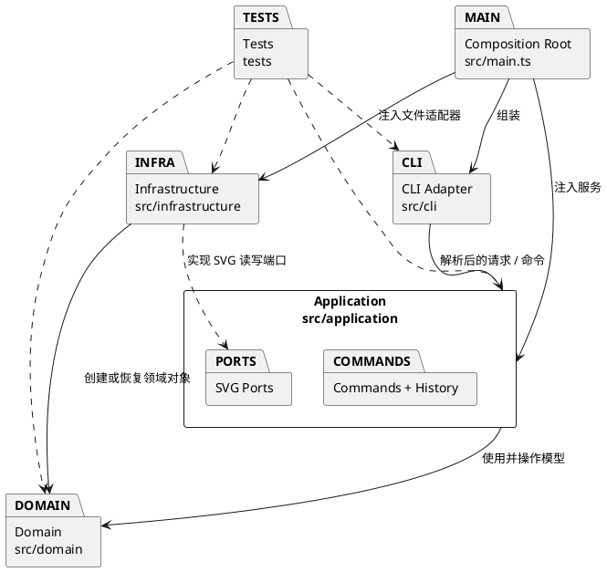

# SVG 编辑器（CLI）架构方案

> 本文记录 Phase 1 的架构约定。当前工程只有阶段说明，尚无实现代码；目录结构是待实施方案，一致性与质量保证部分会随实现进展更新。

## 架构方案

### 1. 模块划分

计划采用以下目录。类按“一类一文件、文件名与类名一致”组织；同一模块中仅将紧密相关的小型类型与其所属类放在一起。

| 模块 | 职责 |
|---|---|
| `src/domain/` | SVG 文档、画布及图形对象模型。以抽象 `Shape` 和多态子类表达图形；`GroupShape` 作为 Composite 容器，维护父子关系与同级顺序；负责 id 唯一性、几何操作和属性约束。不处理终端输入、文件系统或 XML。 |
| `src/application/` | 应用用例与编辑流程。定义 `Command` 抽象、具体命令、命令执行/撤销历史、命令分发，以及 SVG 读写所需的应用端接口。每条编辑命令负责一次完整操作及其逆操作。 |
| `src/cli/` | REPL、逐行输入、注释行处理、命令词法/语法解析、帮助和终端输出。将已解析输入转换为应用命令，不直接修改领域对象。 |
| `src/infrastructure/` | 应用端口的外部适配器：SVG XML 解析与序列化、文件读写。负责缺失 id 的自动分配及警告所需的信息传递；不承载 CLI 业务规则。 |
| `src/` 组合根 | `main.ts` 创建领域文档、应用服务、文件适配器与 CLI，并注入依赖；只负责组装，不实现编辑逻辑。 |
| `tests/` | 对领域模型、命令及撤销重做、CLI 解析、SVG 往返和端到端典型会话进行验证；测试可依赖被测模块。 |
| `doc/` | 架构方案、过程记录、一致性自查和质量保证说明。 |

### 2. 设计模式的选择

- **Command（必须）**：每种编辑操作由独立命令对象表示，统一提供执行和撤销行为。应用层历史记录按成功执行的编辑命令管理 undo/redo；执行失败的命令不得进入历史。组合操作（例如 `group`）作为单个命令，须先验证全部目标，再一次性修改文档，避免失败后留下部分状态。
- **Composite**：所有图形继承统一的 `Shape` 抽象；叶子图形与 `GroupShape` 通过多态实现共同的寻址、移动、缩放、删除和属性操作。容器递归操作子孙；SVG 序列化由基础设施遍历统一的图形树完成，`ungroup` 则作为明确的结构操作。
- **Adapter / Ports and Adapters**：应用层声明 SVG 读取/保存端口，基础设施实现文件与 XML 适配；CLI 只负责交互和语法解析。这样命令与模型不依赖具体终端或文件库。
- **两处类型名分派（按阶段要求保留并标记为待演进点）**：
  1. `src/cli/` 的命令注册表将命令名映射到命令创建/执行入口；
  2. `src/domain/` 的图形工厂将图形类型名映射到对应类。

  这是本阶段明确允许的按名字分派边界，集中在注册/创建入口；图形行为本身使用多态，不在业务代码中散布 `switch(tag)`。若后续需要第三方命令或图形扩展，再将这两处静态映射演进为可注册机制；本阶段不提前实现插件系统，`box` 也不属于本阶段功能。

### 3. 依赖方向规则

1. `domain` 不依赖 `cli`、`application`、`infrastructure`；领域模型不得读写文件或解析命令。
2. `application` 可以依赖 `domain` 及自身声明的端口；不得依赖 CLI、文件系统实现或具体 XML 库。
3. `cli` 可以依赖 `application` 暴露的用例/命令接口；不得直接修改领域对象，也不得依赖基础设施实现细节。
4. `infrastructure` 可以依赖其实现的应用端口和 `domain` 类型；不得反向控制应用流程或依赖 CLI。
5. 只有 `src/main.ts` 组合根可以同时依赖 CLI、应用层和基础设施，以完成依赖注入。
6. `tests/` 可以依赖被测模块；生产模块不得依赖测试代码。

违反上述规则的生产依赖须记录为待处理项，并优先通过端口、依赖注入或领域对象自身行为纠正，而不是以跨层快捷调用绕过边界。

### 4. 变化点假设

| 可能变化的部分 | 本阶段的处理 |
|---|---|
| 新增编辑命令、调整命令参数 | 每条命令独立实现并纳入命令注册表；解析与领域行为分离。命令注册表是唯一按命令名分派点。 |
| 新增图形类型或改变图形行为 | 统一 `Shape` 抽象与具体类；工厂集中图形类型映射，叶子和容器行为通过多态实现。本阶段不建设插件加载机制。 |
| SVG 文件格式细节或 XML 库 | 通过读写端口隔离适配器；XML 解析依赖的具体包在检查/建立项目配置时再确定。 |
| undo/redo 策略与历史限制 | 通过命令的执行/撤销契约和应用层历史管理；文档类操作与画布尺寸修改统一形成历史屏障。 |
| 新的终端交互方式 | CLI 作为独立适配器；应用命令不依赖 REPL，可由另一种交互入口复用。 |
| `box` 等复合图形插件 | 暂不实现。当前 Composite 模型和集中工厂为后续扩展留出位置，但不为尚未要求的插件机制增加复杂度。 |
| 远程存储或其他文件目的地 | 暂不抽象成通用存储平台；仅通过 SVG 端口隔离本阶段所需的本地读写。 |

## 过程记录

- 阅读 `phase_cli_1.md` 后，将工作拆分为先检查并确定架构，再搭建 CLI、领域模型、命令与撤销重做、SVG 读写、测试和交付。
- 按用户要求采用逐步完成、逐步提交远程仓库的推进方式；每一步完成并验证后再开始下一步。
- 步骤一检查发现工程目录尚无实现代码或项目配置；本地 Git 尚无提交，已配置 `origin`，远程当前没有分支。因此本方案先明确模块边界和依赖方向，不假设现有代码结构；后续项目初始化时按实际依赖和工具链补充实现细节。
- 步骤二建立了 TypeScript 工程配置、`src/main.ts` 组合根、`src/cli/Cli.ts` REPL，以及 `src/application/CommandExecutor.ts` 应用边界。当前由 `UnimplementedCommandExecutor` 明确提示命令尚未实现；后续命令实现时会替换它。REPL 支持 `exit` / `quit`，忽略空行与 `#` 开头的整行注释。
- 本阶段仅定义架构，不声称实现或测试已完成。后续实现中发现的设计偏差、修正依据及其影响将在此按时间顺序补记。

## 一致性自查

**状态：部分完成（步骤二）。** 已建立 `src/cli/`、`src/application/` 和 `src/` 组合根，符合当前阶段的模块规划。CLI 仅依赖应用层 `CommandExecutor` 接口，组合根负责具体实现的注入。领域和基础设施模块尚未建立，相关规则待后续实现后检查。后续继续检查：

1. 实际模块与本方案目录是否一致；每项偏差在此记录原因及修订。
2. 生产依赖是否遵守“依赖方向规则”；特别检查 CLI 是否绕过应用层修改模型、应用层是否直接依赖文件/XML 实现，以及领域层是否引入外部交互。

## 质量保证手段

**状态：进行中。** 步骤二在 Node.js `v24.14.0` / npm `11.9.0` 环境验证通过：`npm install` 成功（审计报告 0 vulnerabilities）、`npm run build`、`npm run typecheck` 均通过；将 `help`、注释行、空行和 `exit` 输入送入 `npm run cli` 的启动冒烟检查通过，未实现命令明确返回 `error:` 提示。命令和模型相关测试将在相应功能实现后补充。最终质量依据包括：

- 领域测试：id 唯一性、父子关系、同级顺序、图形几何属性及容器递归操作。
- 命令测试：成功/失败状态、失败无副作用、每条编辑命令的 undo/redo、undo 后新编辑清空 redo、文档类操作形成历史屏障。
- CLI 测试：命令语法、双引号参数、`in` 子句、错误前缀、成功反馈和结构化显示。
- SVG 集成测试：嵌套元素读写往返、缺失 id 自动补齐与警告、非法/不可访问文件报错。
- 端到端检查：回放阶段说明中的典型会话和两节点流程图案例，并在浏览器打开保存的 SVG 确认可渲染。
- 一致性检查：对照本架构图和依赖规则审查实际目录及抽样导入关系；记录执行的检查命令和结果。
