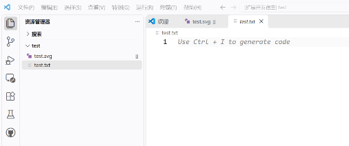
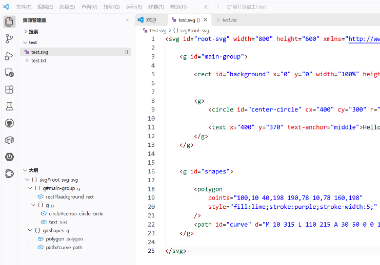

# SVG Explorer Badge

This VS Code extension adds the `[]` Explorer decoration to regular files whose
name ends in `.svg` (case-insensitive). It also contributes nested SVG elements
to VS Code's native Outline view. It does not rename or modify files.
Directories and other file types are not decorated.

## Run from source

1. In a terminal, run `npm install --prefix vscode-extension`.
2. Open the `vscode-extension` folder in VS Code.
3. Open the Run and Debug view, select **Run Extension**, and press F5.
4. In the Extension Development Host, open a folder containing an SVG file.
5. Confirm that regular `.svg` files display `[]`, while a `.txt` file and
   directories do not.
6. Open `examples/outline-demo.svg` and inspect the native Outline view. It
   contains nested groups, identified elements, and a `text` element without an
   id. Select an element to navigate to its source, then edit the SVG and
   confirm the outline updates. Temporarily incomplete XML may show an empty
   outline until it is valid again.

The extension logs file inspection failures to the **SVG Explorer Badge**
output channel and leaves the resource undecorated.

## Tests

Run `npm test --prefix vscode-extension`. The tests cover file decoration
classification and the outline parser's nesting, source ranges, missing ids,
updates, comments, and malformed XML.

## Screenshots

These screenshots were captured from the running Extension Development Host:

## Architecture notes

VS Code owns the workbench, Explorer, document lifecycle, and Outline view. On
activation, this extension registers a `FileDecorationProvider` and a
`DocumentSymbolProvider`; VS Code calls those providers with the relevant URI
or text document. The extension returns presentation metadata and symbols, but
never writes to the SVG or changes its filename.

File decorations are decorator-like because they add presentation information
to an existing Explorer resource without changing the resource itself. This is
not the classic GoF Decorator implementation: the extension does not wrap a
file object implementing the same component interface or forward its
operations. The provider API is closer to an adapter boundary: it maps a VS
Code URI and filesystem stat result to a `FileDecoration`. Likewise, the
outline provider adapts the parser's small tree with source offsets into
VS Code `DocumentSymbol` objects and ranges.

The CLI's SVG codec and domain model are not reused directly. They construct
supported editable shapes, enforce document invariants, and reject unsupported
XML; the Outline needs a lightweight hierarchy for arbitrary element names,
precise source ranges, and an empty result while the user's in-progress XML is
malformed. Reusing the CLI model would impose editor-domain validation without
providing the source-range behavior. The extension instead uses the same
general SAX parsing approach while keeping its outline model local and
read-only.
